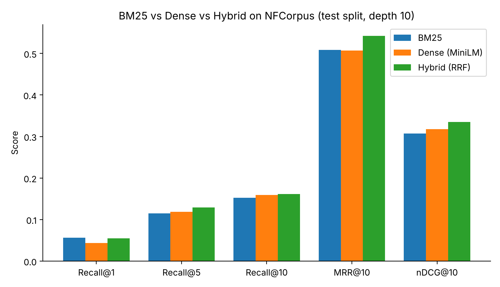
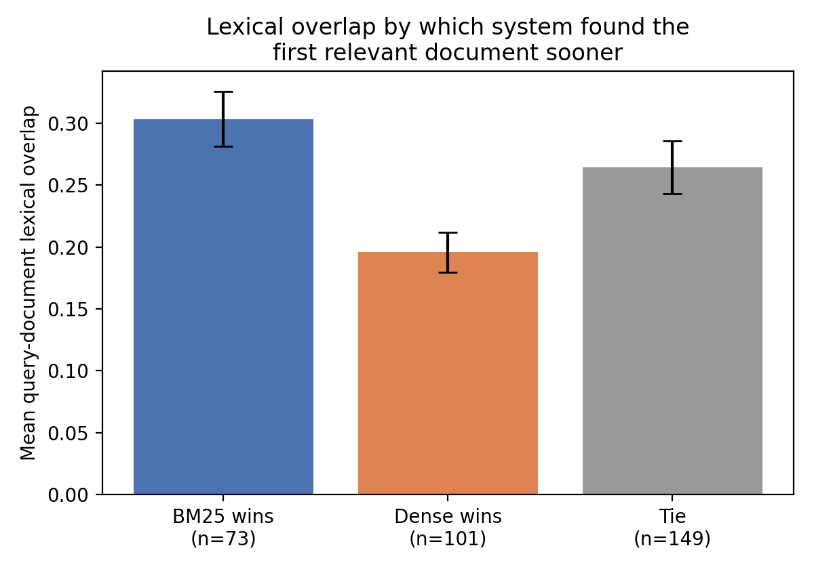

<div align="center">

# BM25 vs. Dense vs. Hybrid Retrieval
### A Comparative Study on NFCorpus (BEIR)


</div>

A controlled comparison of **sparse (BM25)**, **dense (all-MiniLM-L6-v2 + FAISS)** and **hybrid (Reciprocal Rank Fusion)** retrieval on the BEIR **NFCorpus** test split, with paired significance tests and a per-query analysis of *why* and *when* each method wins.

> **Research question:** Does semantic (dense) retrieval outperform keyword-based (BM25) retrieval for biomedical question answering, and where does each approach have the advantage?

📄 **Full paper:** [`report pdf/report.pdf`](report/report.pdf) (LaTeX source in [`report pdf/report.tex`](report/report.tex))

---

## Table of Contents
- [Key Findings](#key-findings)
- [Results](#results)
- [Why Does Each Method Win?](#why-does-each-method-win)
- [Method](#method)
- [Repository Structure](#repository-structure)
- [Quick Start](#quick-start)
- [Reproducibility Notes](#reproducibility-notes)
- [Limitations](#limitations)
- [Citation](#citation)
- [License](#license)

---

## Key Findings

1. **Hybrid RRF is the best system overall.** It scores highest on Recall@5, Recall@10, MRR@10 and nDCG@10, with no training and no tuned weights.
2. **BM25 and dense retrieval are statistically indistinguishable** on most metrics. BM25 is reliably better only on Recall@1 (p = 0.012).
3. **Lexical overlap explains the split.** Queries where BM25 wins share ~55% more words with their relevant documents than queries where dense wins (0.303 vs 0.196; permutation p = 0.0001; Cohen's d = 0.62).
4. **Effects are modest.** Only 2 of 15 paired tests survive a Bonferroni correction (Hybrid > BM25 on nDCG@10; Hybrid > Dense on Recall@1).
5. **Low Recall@k is structural.** NFCorpus queries have ~38 relevant documents each, which caps achievable Recall@10 at roughly 0.26.

## Results

Test split, 323 queries, 3,633 documents; all systems scored at depth 10.

| System         | Recall@1 | Recall@5 | Recall@10 | MRR@10 | nDCG@10 |
|----------------|---------:|---------:|----------:|-------:|--------:|
| BM25           | **0.0565** | 0.1150 | 0.1524 | 0.5085 | 0.3070 |
| Dense (MiniLM) | 0.0436   | 0.1187   | 0.1589    | 0.5068 | 0.3179 |
| Hybrid (RRF)   | 0.0551   | **0.1293** | **0.1612** | **0.5422** | **0.3350** |

<p align="center">
  
</p>

**Paired bootstrap tests** (10,000 resamples over queries; uncorrected two-sided p):

| Comparison | Reliable differences (p < 0.05) |
|---|---|
| Hybrid vs BM25  | Recall@5 (p=0.0034), MRR@10 (0.0036), nDCG@10 (0.0002), Recall@10 (0.049, marginal) |
| Hybrid vs Dense | Recall@1 (0.0006), MRR@10 (0.018), nDCG@10 (0.027) |
| Dense vs BM25   | Recall@1 only (BM25 better, p=0.012) |

Full tables: [`results/matched_depth_table.csv`](results/matched_depth_table.csv), [`results/paired_bootstrap.csv`](results/paired_bootstrap.csv).

## Why Does Each Method Win?

Each query is labelled by which system ranks its first relevant document higher, then compared on **lexical overlap** (fraction of query tokens appearing in the relevant documents).

| Winner | Queries | Mean lexical overlap |
|---|---:|---:|
| BM25  | 73  | 0.303 |
| Dense | 101 | 0.196 |
| Tie   | 149 | 0.264 |

<p align="center">
  
</p>

- **BM25 wins** on short queries built around a rare literal term, e.g. *"molasses"*, *"rickets"*, *"kohlrabi"*.
- **Dense wins** on paraphrased or topical queries, e.g. *"prenatal vitamins"*, *"Preventing Cataracts with Diet"*.

Practical heuristic: measure lexical overlap between expected queries and answers; high overlap favours BM25-heavy retrieval, low overlap favours dense or hybrid. (Supported by one dataset, not a guarantee.)

## Method

```
Query ──► BM25 (rank_bm25, regex tokenizer) ──┐
      ├─► Dense (MiniLM + FAISS IndexFlatIP) ──┼─► RRF (c = 60) ─► Top-10 ─► Metrics
      └────────────────────────────────────────┘
```

| Component | Setting |
|---|---|
| Data | `beir/nfcorpus/test` via `ir_datasets`; title + abstract concatenated |
| BM25 | `BM25Okapi`, default k1/b, lower-case alphanumeric tokens, no stemming/stop-words |
| Dense | `all-MiniLM-L6-v2`, L2-normalised, exact inner-product search |
| Hybrid | Reciprocal Rank Fusion over the top-100 lists, c = 60, truncated to 10 |
| Metrics | Recall@1/5/10, MRR@10, nDCG@10 (linear gain); relevance > 0 counts as relevant |
| Statistics | Paired bootstrap (systems), permutation test + bootstrap CI + Welch t + Cohen's d (overlap) |

## Repository Structure

```
.
├── bm25_vs_dense_retrieval.ipynb   # Main notebook (run from repo root)
├── ir_utils.py                     # Tokenizer, RRF, Recall/MRR/nDCG, statistical tests
├── tests/test_ir_utils.py          # 12 unit tests (no downloads needed)
├── results/                        # CSV result tables
├── figures/                        # Figures used in the paper and README
├── report/                         # report.tex and compiled report.pdf
├── requirements.txt
├── LICENSE
└── README.md
```

## Quick Start

```bash
git clone <this-repo-url>
cd <repo-folder>

python -m venv .venv
source .venv/bin/activate          # Windows: .venv\Scripts\activate
pip install -r requirements.txt

python -m unittest discover -s tests          # fast sanity check
jupyter notebook bm25_vs_dense_retrieval.ipynb
```

The first run downloads NFCorpus and the MiniLM encoder (internet required). A CPU is sufficient; no GPU or API keys are needed. Re-running the notebook regenerates every table and figure, including `results/per_query_analysis.csv`.

Build the paper (two passes of `pdflatex`):

```bash
cd report && pdflatex report.tex && pdflatex report.tex
```

## Reproducibility Notes

- Seeds are fixed (`42`); BM25 and FAISS flat search are exact, so retrieval is deterministic.
- **Protocol correction:** an early run scored BM25/Dense MRR over top-100 lists but Hybrid over top-10 (MRR 0.5113 / 0.5121 / 0.5422). The notebook (Phase 8) re-scores all systems at depth 10 (MRR@10 0.5085 / 0.5068 / 0.5422); the paper uses these matched values. [`results/results_table.csv`](results/results_table.csv) keeps the original numbers for transparency.
- The lexical-overlap analysis averages over **all** relevant documents per query. An earlier version sampled one document from an unordered set and was not deterministic.

## Limitations

- One dataset, one small general-purpose encoder (inputs truncated at 256 word pieces), one fusion rule (RRF, c = 60), untuned BM25 with a simple tokenizer, and a single run.
- The 15 paired tests are not corrected for multiple comparisons in the headline results; absolute gains are small.
- Lexical overlap is a correlational proxy and counts stop-words; the qualitative examples are hand-picked extremes.
- nDCG@10 values are not directly comparable to published BEIR leaderboards (different BM25 implementation and tokenisation).

## Citation

```bibtex
@misc{dalal2026bm25dense,
  author = {Dalal, Aaditya},
  title  = {{BM25} vs. Dense vs. Hybrid Retrieval: A Comparative Study on {NFCorpus}},
  year   = {2026},
  howpublished = {\url{https://github.com/dalalaadi30/BM25-vs.-Dense-vs.-Hybrid-Retrieval-A-Comparitive-Study-on-NFCorpus}}
}
```

Built on: [BEIR](https://arxiv.org/abs/2104.08663) (Thakur et al., 2021), [NFCorpus](https://doi.org/10.1007/978-3-319-30671-1_58) (Boteva et al., 2016), [Sentence-BERT](https://arxiv.org/abs/1908.10084) (Reimers & Gurevych, 2019), and Reciprocal Rank Fusion (Cormack et al., 2009).

## License

Released under the [MIT License](LICENSE). © 2026 Aaditya Dalal.

## Contact

Aaditya Dalal, University Institute of Engineering and Technology, Maharshi Dayanand University, Rohtak, Haryana, <aadityadalal4@gmail.com>


## AI Use

Developed with AI assistance (Claude by Anthropic) for code review, refactoring and writing; experiments were run and results verified by the author.
